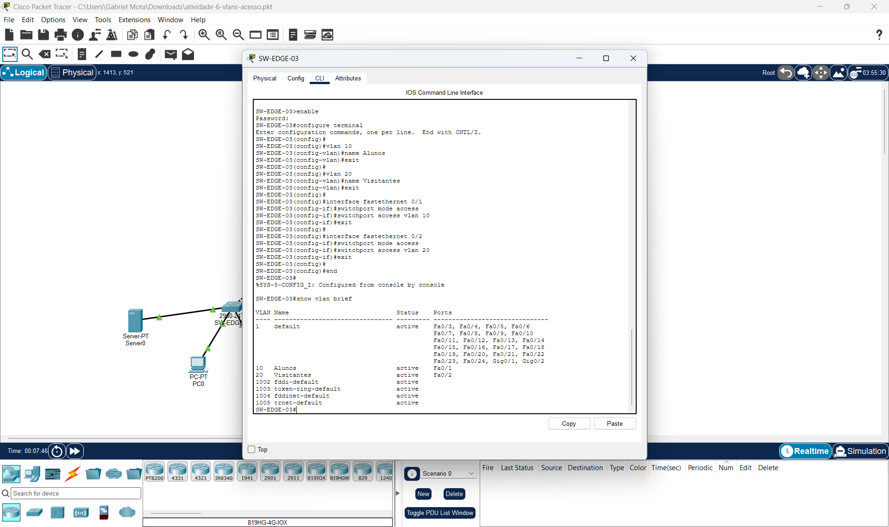
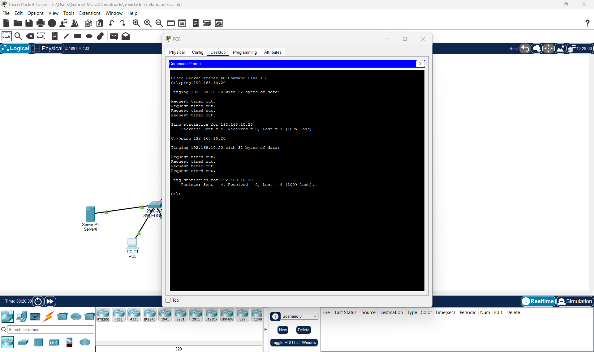

# Atividade 6 — VLANs de acesso em rede hierárquica

Prática de configuração de VLANs nos switches da camada de acesso, desenvolvida no Cisco Packet Tracer.

## Objetivo e escopo

Criar a VLAN **10 — Alunos** nas portas ímpares conectadas aos PCs e a VLAN **20 — Visitantes** nas portas pares conectadas aos notebooks. Nesta etapa, as interligações entre switches ficam fora da configuração de VLANs.

## Projeto

[Baixar o arquivo Packet Tracer](atividade-6-vlans-acesso.pkt). O arquivo registra a versão **9.0.1.0858** do Packet Tracer; recomenda-se essa versão ou uma compatível. Após baixar o repositório, abra o `.pkt` pelo menu File → Open.

## Mapeamento dos dispositivos

Todos os dispositivos abaixo usam máscara 255.255.255.0.

| Switch de acesso | PC / endereço | Porta / VLAN | Notebook / endereço | Porta / VLAN |
|---|---|---|---|---|
| SW-EDGE-01 | PC0 / 192.168.10.10 | Fa0/1 / 10 | Laptop0 / 192.168.10.20 | Fa0/2 / 20 |
| SW-EDGE-02 | PC1 / 192.168.10.11 | Fa0/1 / 10 | Laptop1 / 192.168.10.21 | Fa0/2 / 20 |
| SW-EDGE-03 | PC2 / 192.168.10.12 | Fa0/1 / 10 | Laptop2 / 192.168.10.22 | Fa0/2 / 20 |
| SW-EDGE-04 | PC3 / 192.168.10.13 | Fa0/1 / 10 | Laptop3 / 192.168.10.23 | Fa0/2 / 20 |

Cada switch de acesso utiliza Gi0/1 para a distribuição. O Server0, 192.168.10.100/24, permanece na Gi0/2 do SW-EDGE-01, fora das associações solicitadas para PCs e notebooks.

## Procedimento aplicado

Bloco aplicado em cada um dos quatro switches de acesso:

```text
enable
configure terminal
vlan 10
name Alunos
exit
vlan 20
name Visitantes
exit
interface fastethernet 0/1
switchport mode access
switchport access vlan 10
exit
interface fastethernet 0/2
switchport mode access
switchport access vlan 20
exit
end
copy running-config startup-config
```

Para verificar:

```text
show vlan brief
show interfaces fastethernet 0/1 switchport
show interfaces fastethernet 0/2 switchport
show startup-config
```

## Resultado e revisão

A inspeção do `.pkt` confirmou as duas VLANs, as associações das interfaces e a correspondência entre running-config e startup-config nos quatro switches de acesso. Os recortes de configuração estão em [configuracoes](configuracoes/). A revisão completa e os limites da validação estão em [REVISAO.md](REVISAO.md).

O teste registrado no PC0 foi `ping 192.168.10.20`, destinado ao Laptop0. Houve 100% de perda nas duas tentativas, resultado compatível com o isolamento entre VLANs diferentes. Mesmo usando endereços da mesma faixa IPv4, esses dispositivos estão em domínios de broadcast distintos e não se comunicam diretamente. Nenhuma nova simulação foi executada durante a revisão.

A atividade 6 não habilita transporte das VLANs entre switches nem roteamento entre VLANs. Assim, não se espera comunicação entre PCs de switches distintos nesta etapa. O cenário contém apenas um host de cada VLAN por switch de acesso.

## Evidências da execução

### SW-EDGE-01


### SW-EDGE-02


### SW-EDGE-03


### SW-EDGE-04


### Teste de isolamento — PC0 para Laptop0

